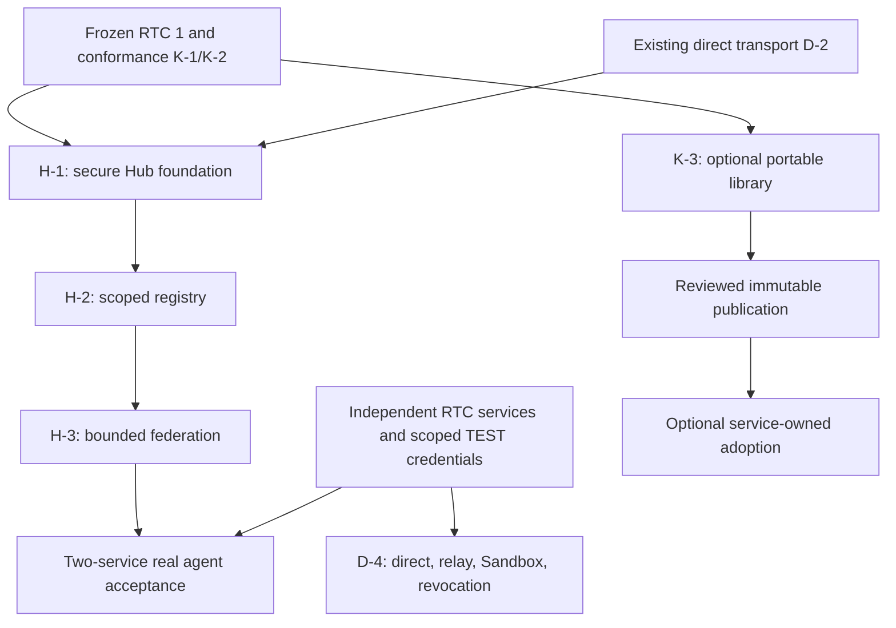

# Universal gateway architecture review and recovery — 2026-10-12

Scope: owner-requested independent review and **documentation/roadmap repair** across six repositories.
This explicit planning request permits these focused documentation PRs; it does not change routine implementation
cadence, CI, security, spending, deployment or independent owner-approval requirements.
This review changes plans, not runtime behavior or completed acceptance. Recheck main and concurrency before coding.

## 1. Verdict and source evidence

**Partially implemented intended architecture; avoidable critical-path coupling in the plan.** Independent services
and RTC HTTPS routing are the right boundaries. The hosted universal gateway is not implemented. K-3 publication and
service source adoption are not technically necessary for H-1–H-3 or D-4 RTC routing. Preserve K-3's existing security
and release tests; remove its mandatory gateway dependency. Source uniformity is not protocol compatibility.

Reviewed current main snapshots (historical evidence, not deployment claims):

| Repository | Main SHA | Reviewed evidence |
|---|---|---|
| robinsons-toolkit-hub | 259d6a0e778d2838366073699b87cedb345ded6e | AGENTS; STATUS; work index; BATCH-H/K; CONTRACT; CLI mcp/dispatch/http; private core package and release guards; D-4 |
| stripe-mcp | e9faf27bbec816146c4e47438762b185fbd52d78 | STATUS; BATCH-R; source MCP dispatcher; R-4r; K3 source handoff; PR #190 permanent handoff and CI addendum |
| google-workspace-mcp | 09a6f7c7ef7ea1e4a65208d3b8edfb74416a3c1a | plan README/IMPLEMENTER/TASKS/ARCHITECTURE; P8 contracts and ledger |
| github-mcp | c11df57c9b77b61af77e917a96b09067d3e046b6 | AGENTS; STATUS; R design/index; RTC-HUB-ADOPTION |
| vercel-mcp | c7ef3483fc31557c395a4b20152f7db3ea6a7eda | AGENTS; STATUS; R design/index; RTC-HUB-INTEGRATION |
| neon-mcp | 99a327342cefc2f16b9c6f331b26cf28f59fd703 | AGENTS; STATUS; R design/index; RTC1-HUB-ADOPTION runbook |

At review start Workspace PR #64 was active. This repair must preserve it and reconcile moving main before merge.
Evidence is source inspection plus identified existing test/handoff evidence; this report does not claim a new real
agent, provider, deployed, memory, latency or connection-count measurement.

Concrete findings:

- No `packages/hub` implementation exists at the reviewed Hub revision. H-1–H-5 remain APPROVED, not built.
- `packages/cli/src/mcp.js` already provides one local stdio MCP connection over multiple RTC HTTPS servers. It lists
  **six tools per credentialed server**, plus opt-in local tools, and throws when serialized listing length/4 reaches
  5,000. It avoids full provider schemas, but tool count is O(servers), not the required fixed gateway surface.
- Startup constructs that local menu without fetching underlying schemas. `dispatch.js` uses `Promise.allSettled`
  for prefix discovery; it still probes every configured server for an unqualified call. `http.js` has a 12-second
  timeout and refuses automatic retry of ambiguous POSTs. Those are useful foundations, not scalable federation proof.
- Current local `safeResult` slices text to 8,192 characters while retaining full `structuredContent` when a handle
  exists. Hosted federation must bound **both**, measure UTF-8 bytes, and preserve valid envelopes/handles rather than
  treating this as accepted result-size behavior.
- H-1's index depends on K-3; BATCH-H requires a released core. The source routing layer imports CLI modules, not the
  private core. This demonstrates that external routing does not need shared server dispatcher adoption.
- Stripe #190 keeps original guarded `stripe_call` and read-only `stripe_batch` in candidate rehearsal. Source allows
  one depth-one guarded TEST write only under `stripe_call`; private core denies all nested writes. Retaining the
  source meta dispatcher preserves capability and guards. The gateway should call RTC endpoints, not import it.
- RTC advertises service-specific modes. Neon records `preview` versus the Hub verifier's strict `test` requirement.
  This is a genuine isolation/acceptance mismatch: do not rename preview or weaken verification to manufacture proof.
- GitHub deliberately advertises RTC 0 pending fuller conformance; do not turn the manifest green for routing.
  Vercel isolated TEST currently allows service identity only, not provider account reads. Those require separate
  acceptance labels; a successful identity check must not be called a provider integration.
- Existing fleet/deployment ledgers distinguish older deployed commits, missing origins, protected credentials and
  public manifests from actual authenticated acceptance. Source fixes and package rehearsals do not close those gaps.

## 2. Root cause and corrected dependency graph

The mandatory **reuse → product** ordering, automatic service migration wording, tiny historical K-3 slices and
repeated status entries put library parity ahead of the gateway's user outcome. Security repairs and original-service
regression tests were valuable; PR volume is not gateway completion. Existing release guards also conservatively
require independent adoption before release while services require a released asset. Candidate rehearsal can provide
pre-release evidence, but production dependency adoption must follow publication. Clarifying stages does not waive
any current release requirement: a future release card must reconcile the machine ledger and exact scope explicitly.

D-4 keeps its direct-door and relay prerequisites; **neither K-3 nor hosted H completion is its prerequisite**.
H-1 can be implemented now against local fixtures. Two genuine services and independently verified deployment/pass
identity gate real acceptance, not foundation coding. H-4/H-5 still complete broader profiles/audit UX; minimum
connection-to-upstream grant narrowing and durable forwarding audit are mandatory already in the H-1–H-3 slice.
A missing credential disables that service/grant only. Full fleet readiness does not gate a two-service vertical slice.

## 3. Target architecture and ownership

Agent → one Hub MCP (hosted Streamable HTTP; local stdio adapter where needed) → authenticated RTC HTTPS tools →
independent specialized MCP → provider. Each specialized MCP also retains its own direct `/api/mcp` connection.
The gateway need not maintain one upstream MCP session per service: current RTC HTTPS doors are sufficient.
Generic non-RTC MCP upstream adapters are a later separately scoped feature, not a prerequisite.

| Concern | Hub owns | Specialized service owns |
|---|---|---|
| Authentication | Hub-issued OAuth/pass identity; per-client consent; caller-to-service grant mapping | Own direct OAuth/pass issuance, revocation and provider connection |
| Credentials | Only separately issued scoped service passes, encrypted and bound to owner/service/grant | Provider keys, OAuth tokens, account/project credentials and encrypted state |
| Definitions | Fixed broker schemas; paged search metadata and bounded per-tool schema cache | Canonical tool schema, effects and provider implementation |
| Execution | RTC routing, request budgets, cancellation, bounded concurrency, partial failure reporting | Wrapped handler, validation, permission, target, TEST/live, write and money guards |
| State/audit | Registry, grants, cache scope/version, forwarding correlation and service log pointer | Durable provider state, rate limits, idempotency, approvals and authoritative change log |
| Results | Bounded wire envelopes; caller-bound routing handles and explicit cursors | Provider shaping, result storage, ownership, pagination and expiry |

A Hub token is never forwarded as a service token. The Hub uses a separately issued service pass for the caller's
authorized grant. Do not use one broad owner pass for all callers; separate upstream grants keep service result scopes
and revocation meaningful. Hub log correlation does not claim the service authenticated the end agent; the service
sees the specific issued grant/pass. Stronger end-user delegation requires a reviewed versioned contract if needed.
No provider credentials in chat. No arbitrary client URL, untrusted descriptions as instructions or browser automation
in the gateway. Enforce approved origins, redirects disabled and private/metadata address defenses at connection time.

## 4. K-3 disposition and staged evidence

**Retain and narrow; optional adoption; remove from gateway critical path.** Existing eleven private exports and tests
remain intact. Stable crypto/HTTP/registry primitives are candidates for reuse; OAuth claim projection, account-bound
AAD, durable storage, permissions, write lifecycle and dispatcher adapters need individual service review.
Do not delete safety tests, claim K-3 complete, or publish the current package from this documentation change.

| Stage | Required proof | What it does not prove |
|---|---|---|
| Portable implementation | Export inventory, provenance, package isolation, fail-closed tests | Original-service parity or deployability |
| Private candidate rehearsal | Immutable source/digest; original adopter HTTP/SQL assertions; adapter exclusions | Released asset or production adoption |
| Immutable publication | Current existing release gates; final reviewed candidate/version; remotely verified asset/digest | Any service has deployed it |
| Optional service adoption | Published pin/checksum; chosen-export parity, rollback; standalone regression suite | Hub connectivity or provider acceptance |
| RTC interoperability | Real service interface and restricted routes; no internal dependency | Full library parity or full service conformance |
| Deployed agent acceptance | Independently verified exact deployed revision; real harmless reads and denial/revocation | Production authorization or scale certification |

Stripe keeps its original meta dispatch. Do not modify the portable nested-write rule solely for uniformity.
If an adopter later requests guarded delegation, require a dedicated trusted service-policy design and original
TEST-write/owner-approval/read-only-batch/depth/identity/audit regressions; no generic argument can authorize it.
A narrowed release must list supported exports and exclusions explicitly. Existing release/adoption gates remain
open until a substantive release card aligns human and machine evidence; this report does not silently remove them.

## 5. Concrete outcome plan and repository ownership

| Outcome / owner | Prerequisites | Acceptance / next action |
|---|---|---|
| H-1 Hub foundation / Hub | K-1, K-2, D-2; reviewed Hub-owned auth/storage boundaries | Write packages/hub and API doors; disposable SQL identity/refresh/revocation; fixed broker menu; no private-core release dependency |
| H-2 scoped registry / Hub | H-1 | Secure owner setup; encrypted service grants; prefix/version/origin checks; per-caller narrowing; bounded namespace listing; missing-grant isolation |
| H-3 federation / Hub | H-2, minimum grant/audit controls | Search/schema/call/read-only batch/results; bounded selective fan-out; cache isolation; refusal passthrough; no ambiguous write retry; two independent RTC fake services |
| Two-service real slice / Hub + Workspace + Stripe | H-3, exact deployed services, secure temporary read_only TEST grants | One actual agent connection; search, schema and real harmless read on each; account restriction, failure and revocation; service standalone recheck |
| D-4 route completion / Hub + each eligible service | Existing direct/relay doors, authenticated ingress/bindings and isolated service credentials | Direct/private encrypted GitHub relay/Sandbox and same-pass revocation recorded separately, independent of K-3 |
| Specialized interface coverage / GitHub, Vercel, Neon | Own approved RTC/isolation cards and owner inputs | Repair modes/resource isolation and supported-subset conformance; verify origins/deployed identity; no broad grants or full-conformance claim from partial reads |
| Optional reuse / Hub + selected adopter | Existing K-3 release gates and separate adoption card | Reconcile candidate exclusions/publication/adoption ledger; reuse only proven exports; preserve original provider semantics |

Workspace is a preferred real target because the owner reports standalone operation; that is not proof of the newer
RTC deployed subset. Stripe is a safe second target **only** for genuine TEST read-only metadata; no money test.
If either is unavailable, keep the real slice OPEN and build the complete fixture-backed federation, then re-enter
when credentials/deployment match. Do not wait for all five providers or default to unrelated local-tool expansion.

## 6. Scalable integration acceptance (design budgets, not measured results)

Keep existing `hub_*` public naming; no rename to illustrative toolkit names required. Fixed search/describe/call/batch/
result/whoami and bounded namespace/health tools; additional workflow enumeration must stay within the same budget.
Do not list six wrappers per service or the provider catalog. Only a requested schema is returned by describe.

Record exact commit, client/version/protocol, fixture/source/deployed status, tool-list count, UTF-8 bytes,
measured tokenizer count (length/4 is only an estimate), startup requests/time/RSS, cache size, sockets/requests,
p50/p95 search/describe/call latency, event-loop delay, errors and queued/active work. Warm and cold runs separately.

| Test | Initial acceptance budget / evidence |
|---|---|
| Growth: 2, 5, 12, 50, 100 registered services; 10,000 aggregate tools | Exactly one agent MCP connection; same broker tool count/names/schemas; listing <5,000 measured tokens; zero eager provider-schema fetches at initialize/list |
| Lazy access | Schema fetched only on describe/needed validation; account/grant/revision-keyed cache; configurable byte/entry/TTL bounds; no cross-caller disclosure |
| Search growth | Paged metadata, cursor-bound authorized service set; default max 4 upstream requests active/query; finite total deadline (initial 15s); incomplete/timeouts explicitly reported |
| Load | 1, 10, 50 callers with global and per-service queue caps; no unbounded Promise fan-out; queue overflow explicit; connections released/reused within measured bounds |
| Memory | 100-service/10k-tool fixture RSS growth <128 MiB above 2-service baseline; 30-minute load with bounded cache/queue shows no continuing monotonic retained growth after settling |
| Failure isolation | One timeout/429/invalid JSON/missing credential/revoked pass does not prevent a healthy service result; no automatic POST replay; failures stay service-labelled |
| Results | Every wire text and structured result <=8 KiB UTF-8 or bounded summary+opaque caller-bound handle; no silent truncation, cross-grant handle access, expired read or forged routing |
| Safety | Duplicate prefixes, unsupported RTC, bad URL/redirect/private-address, stale grant/cache and unauthorized namespace/schema/call denied before protected dispatch |
| Real host | Actual MCP host configured with only Hub; two deployed independent TEST services read successfully, direct connectors still work; negative scope and revocation confirmed |

These defaults may be tuned in a measured implementation card, never presented as proven capacity. Benchmark with
local synthetic services first; no 100-provider paid load or real mutations. Host crashes around 9–12 direct connections
are the owner's observation, not a universal MCP limit. Compare the same host/workload in direct versus Hub mode only
within approved environments; success is demonstrated stability/resource reduction, not just one connection in config.
A two-service real run and synthetic growth test are different evidence; both are needed before claiming scale.

## 7. Immediate actions and real external gaps

Hub: implement the now-ready H-1 card, then H-2/H-3 with minimal grants/audit; reuse tested direct transport without
provider SDK imports. Keep D-4 acquisition active in parallel with eligible implementation.
Services: retain direct MCP; prioritize the already-approved RTC/nonproduction isolation fixes and provide only
redacted exact revision, mode, supported read and denial/revocation evidence. Package adoption is optional.

No new owner decision is required for this planning repair or authorized source/fixture work. Existing IN-06 TEST
scope is not a credential. Real tests still need secure short-lived service-issued passes, independently verified
running SHA/ref/environment, approved isolated accounts/resources and applicable relay issue/actor/ingress bindings.
Neon preview-to-test mismatch requires a service-owned isolation contract, not an alias. Verify current equivalent
constraints for GitHub/Vercel/Workspace. Missing origins are not guessed. Keep scheduled live promotion only, $0
additional spending, production access disabled and Stripe LIVE off. Every AI money-out still requires independent
transaction-specific owner approval plus a separate above-$500/account/Colorado-day override.

## References and version scope

RTC 1 remains frozen; these are Hub planning/implementation constraints, not new mandatory service wire fields.
MCP sources reviewed for the implementation's existing 2025-11-25 protocol pin:
[tools](https://modelcontextprotocol.io/specification/2025-11-25/server/tools) and
[security best practices](https://modelcontextprotocol.io/specification/2025-11-25/basic/security_best_practices).
Pagination does not guarantee clients avoid aggregating a full catalog. Separate Hub and upstream credentials;
retain SSRF, consent, audience and session controls. Protocol upgrades require their own compatibility card.
